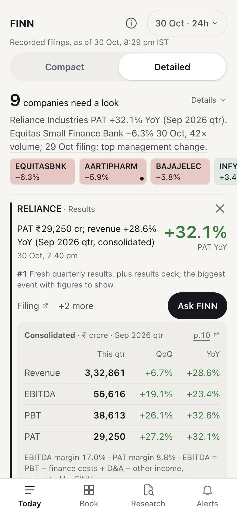
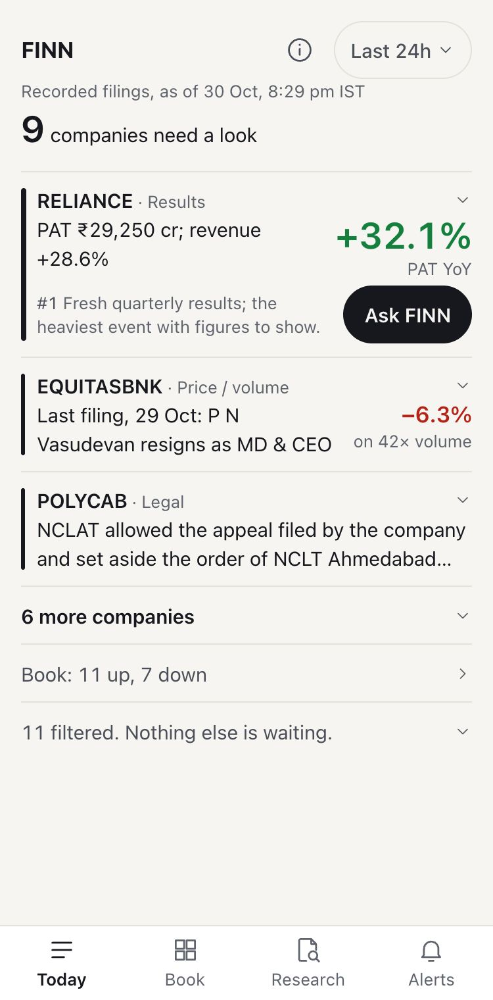
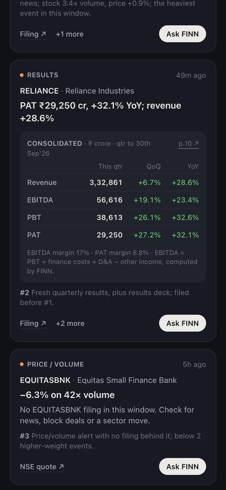
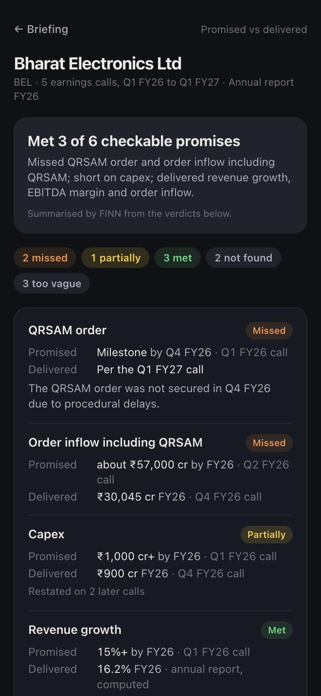
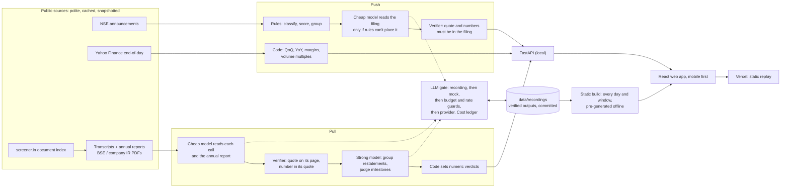

# FINN

A mobile-first investor briefing. You open a ranked answer to what changed across your portfolio, not a chatbox: each company that needs a look, why it ranks there and its figures, the routine paperwork collapsed into a count you can inspect, and every number tied to the page it came from.

**Try it on a phone: https://finn-olive.vercel.app** (a static replay of recorded data; see [what's recorded vs live](#whats-recorded-vs-live))



What to look at first:

- **The table's labels.** Reliance's row says which quarter and which basis, and its table links to the page it was read from.
- **What FINN won't say.** Open Equitas's file: its results table was unreadable, so the figures are withheld. Elsewhere, FINN says what was filed and when, never why a stock moved.
- **A promise followed.** Research, then the Kaynes walk: every step has a speaker and a page, and code does the arithmetic.

<p>
  
  
  
</p>

*Below the hero, the static build at 375px wide: Today in Compact, an opened row, and BEL's promised-vs-delivered scorecard.*

## 2-minute tour

Everything on the public site is recorded data from 9 to 30 October 2026. The same steps are in the app, under (i). It opens dark; the button beside (i) switches to light.

1. **Figures withheld.** Book, then EQUITASBNK: its results table was unreadable, so FINN withholds the figures and links the page.
2. **A promise followed.** [The Kaynes walk](https://finn-olive.vercel.app/#research/KAYNES/PQ1FY26-1): one target from call to call, then what was delivered. Tap a page link.
3. **Labels on every figure.** Book, then RELIANCE: read the results table's basis and period labels.
4. **Your own thresholds.** [Alerts](https://finn-olive.vercel.app/#alerts): change a threshold and see which holdings cross it in the recorded closes.
5. **What it cost.** (i), then How this was built: this copy replays recordings at $0.00. The full per-call cost ledger is on a local run.

## Quickstart (Mac)

Needs Python 3.12 and Node 24 (what CI uses). First run installs dependencies; allow a couple of minutes once.

```bash
git clone https://github.com/adityadeshmukh23/finn.git && cd finn
./run.sh                        # live NSE data for the sample portfolio, then open http://localhost:5173
./run.sh TCS TITAN              # same, plus any other NSE tickers in the briefing
./run.sh research TCS           # record promised-vs-delivered research for any NSE ticker, then start the app
```

- No API key is needed to run. Without one, FINN replays the recordings in `data/recordings/` or uses mock output, and says so.
- `./run.sh research TICKER` makes live model calls, so it needs a free `GEMINI_API_KEY` in `.env` (get one at aistudio.google.com/apikey). It takes a few minutes per company and lands in the Research tab. If the free tier is out of quota it records nothing and tells you to re-run later.
- A ticker that screener.in has no earnings-call transcripts for (ITC, for one) is refused with a plain message, not a guess.
- Tests: `cd backend && ../.venv/bin/pytest -q` and `cd web && npm test`. No key needed.

## What it does

**Push: the briefing.** The Today tab: a windowed digest (24h, 3 days, 7 days, plus an as-of date so it works on quiet days) of every NSE filing across the portfolio. Four tabs: Today, Book, Research, Alerts.

- Dark is the default and light is one tap away, from the button beside (i) or in the (i) sheet. A saved choice wins.
- The layout is text-first. Monogram badges were tried and removed because they did not look good.
- Two views, chosen on Today and remembered on the device. Detailed, the default, opens every row: why it ranks there, its filing and the results table, plus a one-line synthesis and the book strip. Compact shows the top three companies with one number each, the rest a tap away. Ask FINN gives the company file.

- Rules classify and rank each filing; no model is involved in ranking. The order weighs the kind of event, how senior a management change is, company size, other kinds of major filing, and how far a price or volume move went. Routine filings collapse into a filtered count, grouped by reason, with every item inspectable.
- Quarterly results get a table: revenue, EBITDA, PBT, PAT, this quarter vs last quarter and vs a year ago. The cheap model copies figures off the filing; code verifies each figure is printed on the cited page and does all the arithmetic. If it can't, the row shows no numbers and says why.
- Management changes show who, role, effective date, reason (for exits) and background, all from the filing itself.
- End-of-day price and volume alerts (default 2× volume or ±4% in a day), thresholds editable in the app. A holding that crosses a line with nothing material filed in the window gets its own row, which says what was last filed and when. FINN reports what was filed and when, never why a stock moved.
- Each row says why it ranks where it does. **Ask FINN** opens the company file: price and volume, verified results and management changes, every filing since the recording starts, and promised vs delivered where recorded.

**Pull: promised vs delivered.** For a company, what management guided on its last five earnings calls, against what it then reported.

- Primary sources only: transcripts and the annual report. screener.in is used as an index of links, nothing else.
- Where management restated a target, the Guidance Walk follows it call by call: speaker, quote and page at each step, then what was delivered. Code reports the gap ("80.6% of the first promise, 90.7% of the last statement"). The recordings support nine walks: 1 revised and delivered, 5 held and delivered, 3 revised and open.
- Every claim carries a quote, document, period and page. A verifier drops any quote that isn't on its cited page and any number that isn't in its quote. Dropped claims are listed in the app.
- Code sets the verdict on every numeric promise. A stronger model only groups restatements and judges milestones. If the documents don't say, FINN says so.

## What was left out

- Web bios from a model: FINN can't verify them. Bios come from the filing, plus a "Look up background" search link, not checked by FINN.
- The other research lenses, real push notifications and a live backend. [docs/DESIGN.md](docs/DESIGN.md) says why, and [docs/BRIEF_COVERAGE.md](docs/BRIEF_COVERAGE.md) maps the whole brief.

## Architecture



Models are set in one place (`.env`, mapped to tasks in `backend/finn/models.py`): a cheap slot for bulk extraction, a strong slot with a fallback chain for judgement. Both default to Gemini's free tier; swapping either slot to Anthropic is an env change.

## What's recorded vs live

| | Public site | `./run.sh` locally |
|---|---|---|
| Briefing | Replay of NSE filings and Yahoo prices from 9 to 30 Oct 2026, labelled "Recorded filings, as of 30 Oct, 8:29 pm IST" | Live NSE and Yahoo, falling back to the same snapshot with a "data as of" badge |
| Results and management cards | Recorded cheap-model reads of the 30 Oct filings | Same recordings; filings newer than the snapshot get rules only until you run `python -m scripts.read_filings` |
| Research | Recorded for BEL, Kaynes, Coforge, Dixon and Asian Paints | Same, plus anything you record with `./run.sh research TICKER` |
| Model calls | None. No key exists on any public host | Only if you add a key, and only for what isn't already recorded |
| How this was built (cost ledger) | $0.00, and how rules, models and checks fit together | Live ledger: tokens, cost, free-tier limits, $5 hard cap |
| Backend | None. There is no live API behind the public link | FastAPI on :8000 |

The public site cannot fetch live filings or research a new ticker. That is deliberate (no key to leak, nothing that sleeps or hits a cold start), and [docs/DESIGN.md](docs/DESIGN.md) says why.

Unseen tickers: `backend/scripts/smoke_unseen.py` runs the document index, one transcript and one cheap-model read on tickers outside the portfolio and research set. On TCS and Titan it passed; ITC was refused because screener.in lists no transcript links for it. The run writes nothing into the shipped recordings.

## Docs

- [docs/BRIEF_COVERAGE.md](docs/BRIEF_COVERAGE.md): every requirement in the brief, where it lives, and Met, Partly or Not built
- [docs/DESIGN.md](docs/DESIGN.md): decisions and trade-offs, what was left out, known weak spots, next steps
- [docs/COST.md](docs/COST.md): model routing, call counts, tokens, cost
- [docs/DECISIONS.md](docs/DECISIONS.md): the running log, with the why behind each choice
- [docs/BUILD_HISTORY.md](docs/BUILD_HISTORY.md): the build sessions
- [docs/DEPLOY.md](docs/DEPLOY.md): Vercel steps

## Refresh the snapshot and demo data

```bash
cd backend && ../.venv/bin/python -m scripts.record_snapshots 21 && ../.venv/bin/python -m scripts.build_static
```

CI (`.github/workflows/ci.yml`) runs the tests, checks the demo data matches the snapshot and ranking code, fails if a PDF, `.env` or sqlite file is tracked, and builds the web app. It also runs the web tests (`npm test`) and a 130 KB gzip bundle ceiling (`npm run check:size`).
